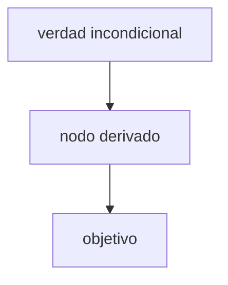

# Lesson visuals

Use a picture for dependencies, flows, sequences, function behavior, convergence, or spatial structure. Skip decoration and pictures that merely repeat a sentence. One idea per picture, fewest carrying elements.

## Structure → Mermaid

Write a Mermaid block directly in the chat and the session note. Obsidian renders it.

Before using it, re-read every arrow: direction means "is needed for". Keep labels short; quote labels with symbols (`A["x = g(x)"]`).

## Plots and geometry → Python

For function plots, errors vs. iterations, interpolation vs. data, vector geometry, and the like:

1. Write a small matplotlib script in `notas/.scratch/` and save a PNG into the topic's `viz/` folder (`notas/<ramo>/<tema>/viz/<nombre>.png`). Use labeled axes, a legend when there is more than one series, log scale where errors span orders of magnitude.
2. **Look at the PNG** with your image/file viewer before using it. Check axes, labels, clipping, and that it shows what you claim.
3. Embed it in the session note with a relative link: ``. In chat, show it if the host can display local images; otherwise describe what it shows and point to the file.

If you cannot view images, say the picture was not visually checked. If no correct picture can be made, omit it and say why. Never use an image-generation model for diagrams: arrows and coordinates must be exact.

## Delegation

A diagram may be delegated to a subagent (Antigravity: `invoke_subagent`, `TypeName='self'`, `Model='flash'`) with one concrete brief and the target path; the subagent must render and look at the PNG before returning. For small pictures, do it yourself.
