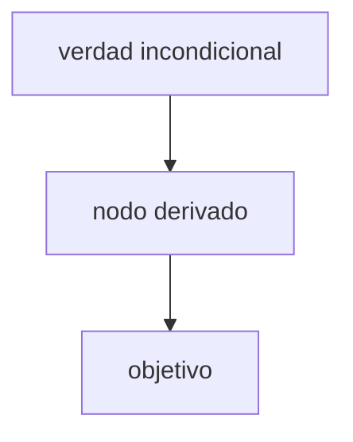

# Sesión: <tema>

- **Fecha:** YYYY-MM-DD
- **Carril:** ramo | independiente
- **Ramo / tema:**
- **Objetivo:**

## Probe

- Meta:
- Borde por hilo (suelo / techo):

### Quiz 1

**Quiz.** …

0. No sé
1.
2.
3.

**Resultado:** correcto ✓ | incorrecto ✗ | no sé | pendiente
Respuesta:
Correcta:
Explicación:

## Plan

### Enfoque

…

### DAG

Aprobado: sí | pendiente

## Teach

### Nodo: <nombre>

- Motivar:
- Establecer:
- Conectar:
- Quiz-check:
- Ejercicio (si aplica):

## Fuentes

- **De tus materiales:** `ramos/<ramo>/material/…`, p. N
- **Material adicional:** `ramos/<ramo>/material-adicional/…`, p. N
- **Teoría estándar:** nombre + sección / enlace
- **Incierto:** qué quedó sin verificar

## Pendientes

- siguiente nodo:
- conflictos abiertos:
